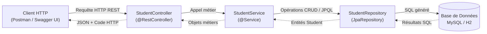

# TP 6 — Gestion des Étudiants avec Spring Boot, Spring Data JPA & Swagger OpenAPI

> **ARCHITECTURE MICROSERVICES LAB**  
> Édition pédagogique : `TP6-SPRINGBOOT-STUDENT-2026`

---

Ce projet met en œuvre une API REST complète de gestion des étudiants (`student-management`) construite avec **Spring Boot 3**, **Spring Data JPA**, **Hibernate**, et documentée avec **Swagger / OpenAPI (springdoc-openapi)**. Il inclut des tests unitaires rapides avec **JUnit 5 & Mockito** ainsi que des tests d'intégration avec **H2 in-memory**.

---

## 📋 Table des matières

1. [Objectifs du TP](#-objectifs-du-tp)
2. [Architecture globale & Flux de requête](#-architecture-globale--flux-de-requête)
3. [Structure du projet](#-structure-du-projet)
4. [Détail des composants](#-détail-des-composants)
   - [Entité Student](#1-entité-student)
   - [Repository Spring Data JPA](#2-repository-spring-data-jpa)
   - [Couche Service](#3-couche-service)
   - [Contrôleur REST](#4-contrôleur-rest)
   - [Documentation interactive Swagger](#5-documentation-interactive-swagger)
5. [Endpoints REST exposés](#-endpoints-rest-exposés)
6. [Compilation et exécution](#-compilation-et-exécution)
7. [Tests unitaires (JUnit 5 & Mockito)](#-tests-unitaires-junit-5--mockito)

---

## 🎯 Objectifs du TP

- Initialiser un projet Spring Boot moderne avec Spring Initializr / Maven.
- Configurer la persistance relationnelle avec Spring Data JPA et MySQL.
- Développer une couche d'accès aux données avec des requêtes personnalisées JPQL (`@Query`).
- Implémenter une couche service isolant la logique métier et les transactions.
- Développer et documenter les endpoints REST avec Swagger UI.
- Écrire des tests unitaires isolés avec JUnit 5 et Mockito.

---

## 📐 Architecture globale & Flux de requête



---

## 📁 Structure du projet

```text
TP 6/
├── pom.xml                                      # Dépendances Spring Boot 3, Spring Data JPA, Swagger, MySQL, H2
├── README.md                                    # Documentation complète du TP
├── .project / .classpath / .gitignore           # Métadonnées Eclipse et Git
└── src/
    ├── main/
    │   ├── java/
    │   │   └── com/example/studentmanagement/
    │   │       ├── entity/
    │   │       │   └── Student.java             # Entité JPA (@Entity, @Table(name="students"))
    │   │       ├── repository/
    │   │       │   └── StudentRepository.java   # Interface Spring Data JPA avec requête JPQL par année
    │   │       ├── service/
    │   │       │   └── StudentService.java      # Logique métier et manipulation des étudiants
    │   │       ├── controller/
    │   │       │   └── StudentController.java   # Contrôleur REST avec annotations Swagger @Operation
    │   │       └── StudentManagementApplication.java # Point d'entrée (@SpringBootApplication)
    │   └── resources/
    │       └── application.properties           # Configuration DataSource MySQL 8 & Swagger UI
    └── test/
        ├── java/
        │   └── com/example/studentmanagement/
        │       ├── StudentControllerTest.java   # Tests unitaires isolés (JUnit 5 + Mockito)
        │       └── StudentIntegrationTest.java  # Tests d'intégration de bout en bout (H2 in-memory)
        └── resources/
            └── application.properties           # Configuration H2 pour les tests automatisés
```

---

## 🛠️ Détail des composants

### 1. Entité Student
```java
@Entity
@Table(name = "students")
public class Student {
    @Id
    @GeneratedValue(strategy = GenerationType.IDENTITY)
    private int id;
    private String nom;
    private String prenom;

    @Temporal(TemporalType.DATE)
    private Date dateNaissance;
}
```

### 2. Repository Spring Data JPA
L'interface [`StudentRepository.java`](file:///z:/JEE%20architecture%20micro%20service/Architecture%20Microservices/TP%206/src/main/java/com/example/studentmanagement/repository/StudentRepository.java) étend `JpaRepository<Student, Integer>` et déclare :
- `Student findById(int id)` : Recherche par clé primaire.
- Requête JPQL d'agrégation statistique :
  ```java
  @Query("SELECT YEAR(s.dateNaissance), COUNT(s) FROM Student s GROUP BY YEAR(s.dateNaissance)")
  Collection<Object[]> findNbrStudentByYear();
  ```

### 3. Couche Service
[`StudentService.java`](file:///z:/JEE%20architecture%20micro%20service/Architecture%20Microservices/TP%206/src/main/java/com/example/studentmanagement/service/StudentService.java) fournit :
- `save(Student student)` : Enregistre ou met à jour un étudiant.
- `delete(int id)` : Supprime un étudiant s'il existe et renvoie un booléen.
- `findAll()` : Liste tous les étudiants.
- `countStudents()` : Compte total des étudiants.
- `findNbrStudentByYear()` : Répartition par année de naissance.

### 4. Contrôleur REST & Swagger
[`StudentController.java`](file:///z:/JEE%20architecture%20micro%20service/Architecture%20Microservices/TP%206/src/main/java/com/example/studentmanagement/controller/StudentController.java) expose les routes REST sous le préfixe `/students`.

---

## 🌐 Endpoints REST exposés

| Méthode | Endpoint | Code HTTP attendu | Description |
| :--- | :--- | :--- | :--- |
| **POST** | `/students/save` | `201 Created` | Ajout d'un étudiant (reçoit un JSON) |
| **GET** | `/students/all` | `200 OK` | Récupération de tous les étudiants |
| **DELETE** | `/students/delete/{id}` | `204 No Content` / `404 Not Found` | Suppression d'un étudiant par son ID |
| **GET** | `/students/count` | `200 OK` | Nombre total d'étudiants enregistrés |
| **GET** | `/students/byYear` | `200 OK` | Statistiques du nombre d'étudiants par année |

### Documentation Swagger Interactive :
Une fois l'application démarrée, accédez à :
👉 **`http://localhost:8080/swagger-ui.html`**

---

## 🚀 Compilation et exécution

### 1. Exécuter les tests automatisés :
```powershell
mvn clean test
```

### 2. Démarrer l'application Spring Boot :
```powershell
mvn spring-boot:run
```

---

<div align="center">

`ARCHITECTURE MICROSERVICES LAB · TP6-SPRINGBOOT-STUDENT-2026`

*Développement d'APIs REST modernes avec Spring Boot, Spring Data JPA et Swagger.*

</div>
